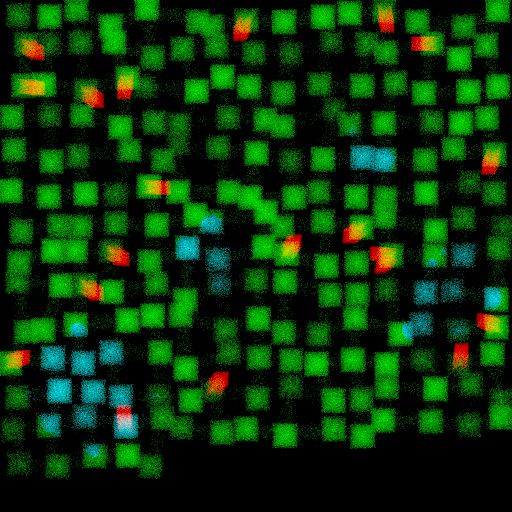
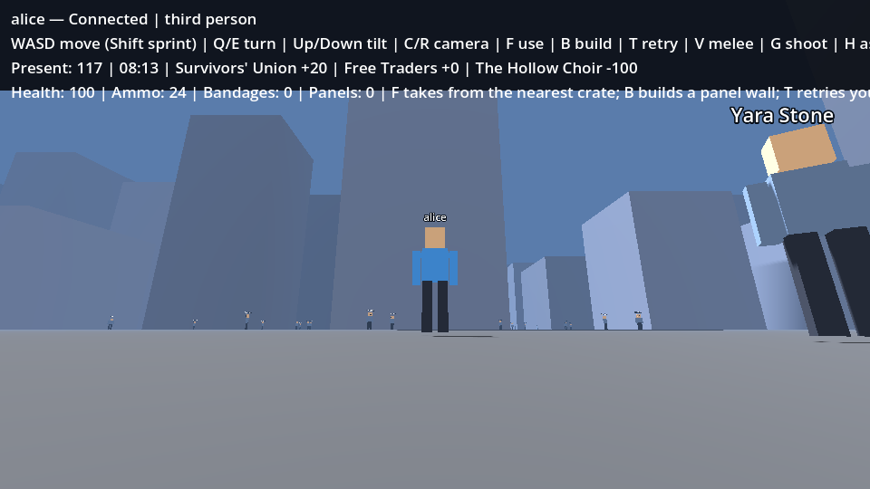
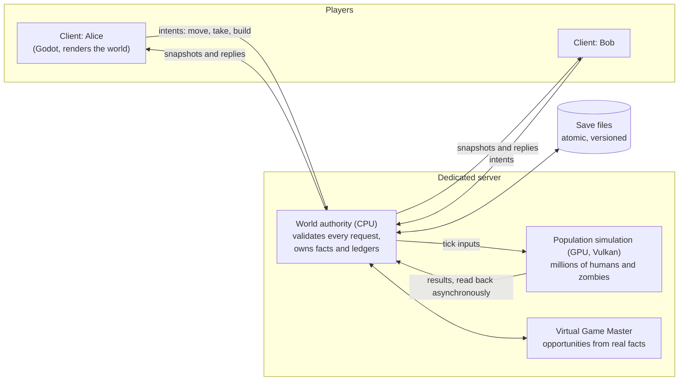
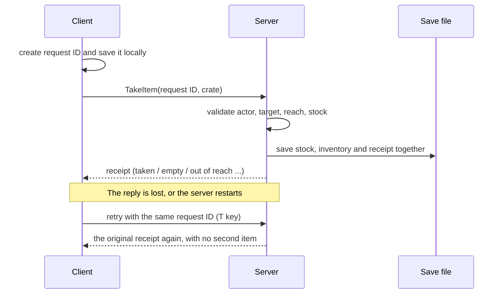
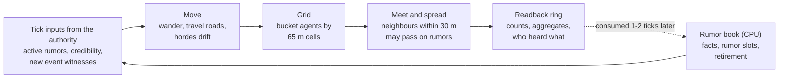
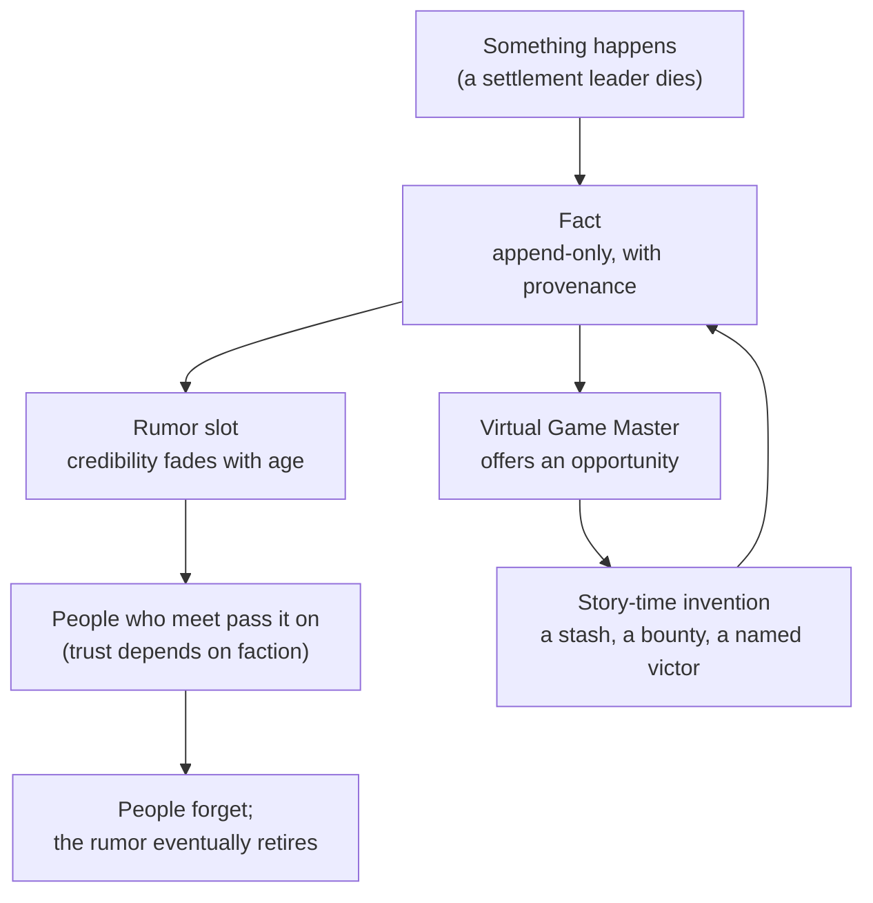
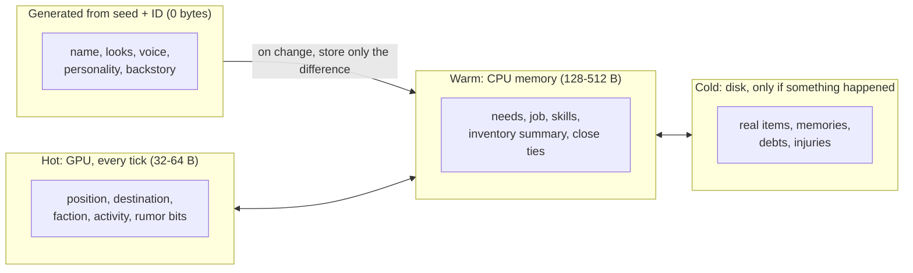
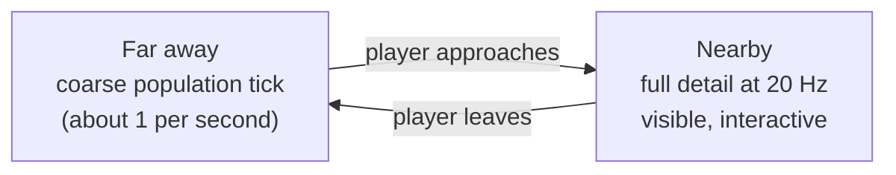
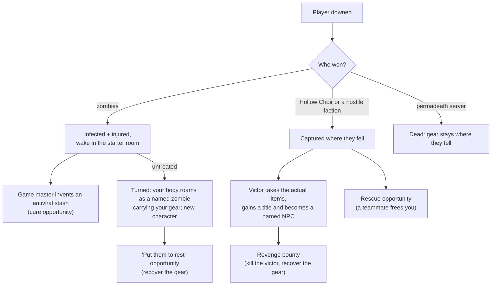
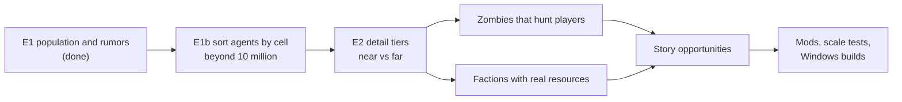

# QuestSim

**A living multiplayer world, starting with cooperative zombie survival.**

QuestSim is an experimental game project built with Godot 4 and C#. The goal is a world that keeps
living whether or not anyone is watching. Humans and zombies persist with their own factions,
rumors travel by word of mouth, players build bases from modular pieces, and stories grow out of
what actually happened in the world rather than out of a fixed quest list.

> **Status: early experimental phase.** Everything here is a working hypothesis that we test and
> measure, and expect to change. The art is deliberately placeholder boxes: the focus is on getting
> the foundations right first.

**Quick links:** [Resume handoff](HANDOFF_2026-10-25.md) ·
[Current task](questsim_planning_kit/CURRENT_TASK.md) · [Project state](questsim_planning_kit/STATE.md) ·
[Runbook (all commands)](questsim_planning_kit/RUNBOOK.md) ·
[Director decisions](questsim_planning_kit/DIRECTOR.md) ·
[Latest experiment results](questsim_planning_kit/E1_RESULTS.md)

---

## Contents

- [The vision](#the-vision)
- [Design principles](#design-principles)
- [Inspirations](#inspirations)
- [Where the project is today](#where-the-project-is-today)
- [Architecture](#architecture)
- [Getting started](#getting-started)
- [Tests and experiments](#tests-and-experiments)
- [Repository layout](#repository-layout)
- [Platforms and known limits](#platforms-and-known-limits)

---

## The vision

Most open-world games freeze everything you aren't looking at. QuestSim tries the opposite.

- **Everyone persists.** Every human and zombie keeps an identity, a location and a history across
  play sessions. Nobody is a disposable spawn.
- **The world doesn't revolve around the player.** NPCs and factions pursue their own goals under the
  same rules as players. That includes zombie hordes, which get factions and internal politics of
  their own.
- **Information spreads the way it does in real life.** Events become facts. Facts become rumors that
  pass between people who meet, fade over time, and depend on who trusts whom.
- **Stories come from the world.** A quest-giver's lost cart is a real object in a real place, and
  what you find there depends on what else has happened nearby.
- **Co-op first.** Friends share one world. Items, inventories and story-created content are the same
  for everyone, so what one player leaves behind is exactly what the next player finds.

The first game set in this world is cooperative zombie survival: scavenge, build, and live among
factions of survivors (and hordes) who have their own plans.

---

## Design principles

| Principle | What it means in practice |
| --- | --- |
| **Experiment, measure, then commit** | New ideas start as small, disposable experiments with numbers attached. Failed experiments are useful results, not embarrassments. |
| **The simplest thing that works** | Build only what the current step needs. No speculative frameworks, engines or abstractions "for later". |
| **One source of truth** | A single authoritative server decides what happened. Clients ask; the server validates and commits. |
| **Nothing duplicates, nothing vanishes** | Item transfers and building costs happen exactly once, even if a reply is lost or the server restarts. Saves never silently reset. |
| **Shared rules** | Players, NPCs and zombies live under the same world rules. The player is one actor among many, not the center. |
| **Stories may invent, then they're real** | When a story needs a detail (a coin purse left in a cart), the world can create it on the spot, shaped by what's already there. Once created, it's a committed fact that every player sees the same way. |
| **Foundations before art** | Simulation, persistence and multiplayer correctness come before visuals and content volume. |
| **Moddable by design** | Content is meant to be data (items, factions, buildings, story templates) behind a supported mod surface. |

---

## Inspirations

- **OnceLost Games' *The Wayward Realms* devlog** is the biggest influence on the simulation design.
  Their ideas include:
  - storing millions of NPCs as plain numbers that the GPU updates in parallel
  - spreading rumors through proximity and trust
  - building quests from a graph of world facts, with details filled in lazily when a player arrives
  - painting the world as editable layers, with procedural detail on top

  QuestSim isn't a copy. We take the ideas that fit a multiplayer survival game and test them with
  our own measurements; see the [video review](questsim_planning_kit/VIDEO_REVIEW.md).
- **Valheim** sets our pace of time: about **48:1**, so one in-game day lasts 30 real minutes.
- **Project Zomboid** and **7 Days to Die** are reference points for persistent survival worlds, bases
  and hordes (both default to roughly one-hour days).

---

## Where the project is today

Each milestone is small, tested end to end, and recorded with evidence.

| Milestone | What it proved | Results |
| --- | --- | --- |
| **Q00** Presentation comparison | Low-poly 3D with first/third-person cameras was chosen over 2D and sprites | [results](questsim_planning_kit/PRESENTATION_EXPERIMENT.md) |
| **Q01** Shared room | A dedicated server and two real clients; movement, reconnects and saves | [results](questsim_planning_kit/Q01_RESULTS.md) |
| **Q02a** One item | Two players race for one bandage; exactly one wins, and retries never duplicate it | [results](questsim_planning_kit/Q02_RESULTS.md) |
| **Q02b** One wall | Two players race to build in the last free cell; the cost is paid exactly once | [results](questsim_planning_kit/Q02B_RESULTS.md) |
| **E1** Population and rumors | 10 million simulated agents on the GPU, bit-identical to the CPU reference | [results](questsim_planning_kit/E1_RESULTS.md) |
| **Nightly** v1.0 foundation *(branch `nightly`)* | A generated 40 × 40 km city; a million persistent agents with detail near players; zombies, cultists and factions; melee and pistol; defeat instead of death; a game master that turns facts into opportunities; rumors by word of mouth; data-defined items and mods; CI on Linux and Windows | [log](questsim_planning_kit/NIGHTLY_2026-10-26.md) |

A world of one million agents from the E1 experiment. Green is humans (with faint travel streaks
between settlements), red is migrating zombie hordes, and cyan is people carrying a rumor outward
from where an event happened:



And inside the game, on the `nightly` branch: the plaza outside the starter building, with Survivors' Union
members in the street and the downtown towers behind them.



---

## Architecture

> Everything below runs on the `nightly` branch except parts marked *(planned)*.

### The big picture



- **Clients** only send *intents* ("I want to move", "I want to take that") and draw what the server
  tells them.
- **The world authority** runs on the CPU. It decides what actually happens, and it alone owns facts,
  inventories and transactions.
- **The population simulation** runs on the GPU. It moves millions of agents, finds who is near whom,
  and spreads rumors. The authority never waits for it: results are picked up a tick or two later.

### Exactly-once actions

Every pickup or build has a request ID. The server saves the result *before* replying, so a lost
reply or a server crash can never turn one click into two items.



### One population tick

A population tick covers 48 seconds of game time and runs about once per real second. Every step
uses integer math only, so the GPU produces exactly the same result as the CPU reference
implementation, bit for bit.



### Facts, rumors and stories



Rumors change what people *believe*. They never change what *happened*.

### How much each NPC can carry

Most of an NPC is never stored at all. It's regenerated from the world seed and the NPC's ID, and it
comes out the same every time and for every player. Only what actually happens to them is saved.



At 10 million NPCs that's roughly 0.5 GB of GPU memory and a few GB of RAM, with rich detail only for
the people that players and events have actually touched.

### Detail near players, coarse far away



The same individual moves between tiers without being lost, duplicated or reset. Agents within 120 m of a
player are simulated at 20 Hz (zombies and hostile factions hunt, others go about their business) and
return to the coarse 1 Hz population tick when players move more than 180 m away. Factions also act on
each other: zombies and humans fight, the Hollow Choir fights everyone, and the two horde factions hold
separate territories and clash where they meet. Days pass at 48:1, and people head home at night.

### Defeat instead of death



Clocks for infection, captivity and injury only run while that player is online. Every item that changes
hands is recorded in a ledger, so nothing is ever duplicated or lost along the way.

### Roadmap



The order and scope are revisited after each experiment.

---

## Getting started

Development happens on **Linux**; the full test suite also runs natively on **Windows 11** (Git Bash).

**Requirements:** .NET SDK 10.0.110 (pinned in `global.json`) and Python 3. For the GPU experiment you
also need a Vulkan driver and `glslc` (from the Vulkan SDK or shaderc). Godot is downloaded locally by
the install script; nothing is installed system-wide.

```bash
bash scripts/install_godot.sh     # pinned Godot 4.6.2 (.NET), checksum-verified, into .tools/
bash scripts/build_game.sh        # build the game
```

Then run each of these in its own terminal:

```bash
bash scripts/run_server.sh
bash scripts/run_client.sh alice
bash scripts/run_client.sh bob
```

**Controls:**

| Keys | Action |
| --- | --- |
| WASD | Move |
| Q / E | Turn or orbit the camera |
| Up / Down | Tilt the camera |
| C | Switch between first and third person |
| R | Reset the camera |
| F | Use: free a captive teammate, loot a cache, or take from the nearest crate |
| B | Build a wall panel on the orange cell |
| T | Retry your last saved pickup or build |
| V | Melee attack |
| G | Fire the pistol |
| H | Ask the nearest person what they've heard |
| U | Use your best healing item |
| I | Inspect the nearest NPC (debug view) |
| Shift | Sprint |

Close a client to leave, and relaunch the same profile name to return as the same character. World
time pauses when nobody is connected. Play data is kept in `.artifacts/play/`.

---

## Tests and experiments

Tests start real server and client processes. They run headless wherever possible, and use a private
virtual display (Xvfb) when actual rendering or key presses need checking.

```bash
bash scripts/check.sh                          # offline game-rule checks
python3 scripts/verify_build.py                # wall-building race, retries, crash recovery
python3 scripts/verify_build_screen.py         # real key presses + screenshots on a virtual display
python3 scripts/verify_items.py                # item pickup race and recovery
python3 scripts/verify_multiplayer.py          # two-client networking regressions
python3 scripts/verify_living.py               # population tiers, combat, asking NPCs, snapshots, 1M-agent budget
python3 scripts/verify_defeat.py               # capture, rescue, infection turning a player
python3 scripts/verify_content.py              # data-defined items, example mod, missing-mod refusal
python3 scripts/verify_city_screen.py          # populated city rendered on a virtual display
python3 scripts/inspect_world.py WORLD.json    # read-only summary of any save

bash scripts/run_population.sh check           # population experiment: CPU vs GPU bit-identical
bash scripts/run_population.sh bench --agents 1e5,1e6,1e7
bash scripts/run_population.sh run --agents 1e6 --world-km 60 --image world.png
```

The [runbook](questsim_planning_kit/RUNBOOK.md) lists every command, with expected results.

---

## Repository layout

| Path | What's there |
| --- | --- |
| `src/QuestSim.Domain/` | Game rules as plain C# with no engine dependency: authority, saves, validation |
| `src/QuestSim.Game/` | The Godot project, used as both the server and the client |
| `content/`, `mods/` | Data-defined items (core) and an example data-only mod |
| `checks/` | Offline checks of the game rules |
| `experiments/population/` | The E1 population and rumor experiment (Vulkan + C# reference) |
| `experiments/presentation/` | The original 2D / sprite / low-poly comparison |
| `scripts/` | Build, run and test scripts |
| `questsim_planning_kit/` | Vision, decisions, current task, state, results and research notes |

---

## Platforms and known limits

- **Targets:** Windows and Linux. macOS is a stretch goal; Mac players could try a compatibility layer
  such as CrossOver, which hasn't been tested.
- **Verified so far:** Linux and Windows 11 (all automated suites; the Windows GPU run was on a Radeon RX 5700),
  2–8 players on loopback, and a Linux client playing on a Windows server over a LAN. Exported builds, WAN
  and a graphical Windows client haven't been tested yet.
- **Game world (nightly):** one million agents by default (`--population=N`), which the server's CPU
  path handles at 20 ticks per second; population snapshots save in the background every 60 seconds.
- **Simulation experiment:** about 10 million agents at one population tick per second on an RTX 3080 Ti. Going
  beyond that needs better memory locality (the next experiment, E1b).
- **Content:** one room, one crate of bandages, one crate of wall panels and one build cell. The
  living-world systems are being built and measured separately before they join the game.

QuestSim is developed with AI coding agents working under the decisions in
[DIRECTOR.md](questsim_planning_kit/DIRECTOR.md). Every result in this repository is backed by a
check or a measurement you can rerun.
